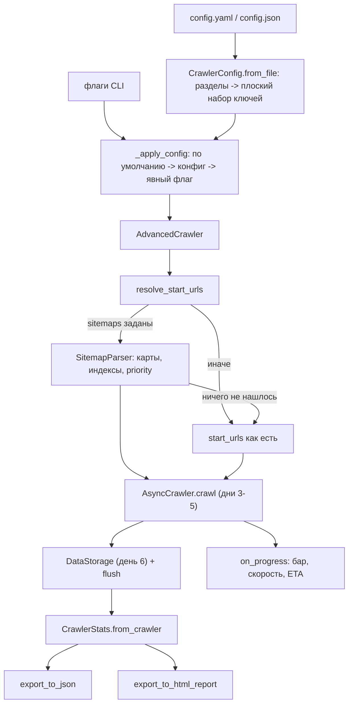

# Алгоритм: День 7 — продвинутые возможности и финальная интеграция

## Путь одного прогона



День 7 почти ничего не вычисляет сам — он соединяет готовое. Поэтому главные
решения тут не алгоритмические, а о том, кто чем владеет.

**`AdvancedCrawler` — композиция, а не наследник.** `AsyncCrawler` остаётся
библиотекой: его можно взять без конфигов, отчётов и логирования. Класс дня 7
решает, что обходить и что делать с результатом, и держит внутри краулер,
хранилище и статистику.

**Конфигурация и CLI говорят на одном языке.** Ключи конфига названы как флаги
(`max_pages`, `rate_limit`, `respect_robots`), поэтому файл читается как
сохранённая командная строка. Перевод в имена библиотеки собран в двух методах
— `to_crawler_kwargs()` и `to_crawl_kwargs()`, — и больше нигде имена не
расходятся.

**Статистика — агрегатор без состояния.** `CrawlerStats` ничего не считает по
ходу обхода: она собирается из `crawler.results`, страниц и
`get_crawl_stats()`. Один и тот же прогон можно посчитать дважды и получить тот
же отчёт.

## Карта сайта

[../src/sitemap.py](../src/sitemap.py). Карта — самый дешёвый источник адресов:
сайт сам перечисляет страницы, которые хочет отдать, и ходить по ссылкам ради
того же набора незачем.

Загрузку `SitemapParser` не делает — `fetcher` передаётся снаружи, ровно как у
`RobotsParser` дня 4. Поэтому класс не знает ни про `aiohttp`, ни про сессию, а
тесты обходятся без сети. В краулере загрузчиком служит `_fetch_sitemap` поверх
общего `_fetch_plain`: служебные файлы идут мимо проверки robots.txt (иначе для
самого robots.txt вышла бы рекурсия), но через лимит скорости и семафоры — это
такие же запросы к сайту.

### Два вида файлов

Вид определяется корневым тегом, а не содержимым: по спецификации `<urlset>` и
`<sitemapindex>` смешивать нельзя, и угадывать нечего. Файл без обоих корней
возвращается с `kind=unknown`, и вызывающий решает, считать это ошибкой —
`SitemapParser` считает.

Индексы разворачиваются обходом в ширину. Четыре предела:

| Предел | Значение | Зачем |
| --- | --- | --- |
| `visited` | — | карта, ссылающаяся сама на себя, загружается один раз |
| `max_depth` | 3 | вложенные индексы встречаются, бесконечные — тоже |
| `max_sitemaps` | 50 | индекс на тысячу файлов не должен занять весь прогон |
| `max_urls` | 50 000 | карта на миллион адресов обрезается, а не съедает память |

Сработавший предел ставит `truncated=True` и пишет в лог причину: обрезанный
результат должен быть виден, а не выглядеть как полный.

### Мелочи разбора, которые решают дело

`<loc>` ищется только среди прямых детей `<url>` и только у тегов без префикса:
внутри записи лежит ещё и `<image:loc>`, и картинка не должна попасть в список
страниц. Относительные адреса достраиваются по адресу самой карты — стандарт
требует абсолютных, но в живых картах относительные встречаются, и достроить их
дешевле, чем потерять. Адрес, который нечем загрузить (`mailto:`,
`javascript:`), отбрасывается.

Разбор идёт в `asyncio.to_thread`: он синхронный и целиком CPU-bound, а карты
бывают на десятки мегабайт.

Сжатые карты (`sitemap.xml.gz`) распаковываются: стандарт их разрешает, и
крупные сайты отдают карту только так. Сжатие определяется по первым байтам
тела, а не по расширению или заголовку — встречается и `.gz` без
`Content-Type: application/x-gzip`, и наоборот. Архив, обрезанный по лимиту
размера, распаковать нечем, и это честно считается ошибкой чтения карты.

Лимит в 10 МБ действует и на распакованный размер: читается ровно столько,
сколько разрешено файлу, а остальное отбрасывается с предупреждением в лог.
Иначе лимит защищал бы только от крупного архива, но не от маленького:
повторяющийся XML карты сжимается в сотни раз (проверено: 26,7 МБ в 93 КБ,
то есть x294), так что разрешённые 10 МБ архива развернулись бы в память
воркера гигабайтами — и это без всякого умысла со стороны сайта.

`<priority>` без значения считается 0.5 — так написано в спецификации.
`sort_by_priority` сортирует устойчиво, поэтому внутри одного приоритета
сохраняется порядок карты: сайт перечисляет страницы не случайно. Очередь
обхода при равном приоритете работает как FIFO, значит отсортированный список
сохранит свой порядок и менять сигнатуру `crawl()` не пришлось.

### Где искать карту

`discover_sitemaps(url)` сначала смотрит в robots.txt, потом пробует
`/sitemap.xml`. robots.txt загружается даже при выключенном `respect_robots`:
спрашиваем не разрешение, а адрес карты, и другого стандартного способа узнать
его нет.

Директива `Sitemap:` разбирается в [../src/robots.py](../src/robots.py) до
проверки групп и не закрывает перечисление агентов. Она адресована всем и может
стоять до первого `User-agent`, а если бы она закрывала группу, строка между
двумя `User-agent` разбила бы одну группу на две — и у второго агента правила
пропали бы. Относительный адрес в директиве (`Sitemap: /sitemap.xml`) стандарт
запрещает, но он встречается, поэтому `discover_sitemaps` достраивает его по
адресу сайта — так же, как разбор `<loc>` внутри карты.

`seeds_from_sitemaps(..., base_urls=...)` — единственное место, где
разворачивается значение `auto`. И CLI, и `AdvancedCrawler` зовут его, поэтому
логика «найди карту сам» не продублирована.

| Метод | Возвращает |
| --- | --- |
| `SitemapParser.fetch_sitemap(url)` | список адресов страниц (как в задании) |
| `SitemapParser.fetch_sitemaps(urls)` | то же для нескольких карт, без повторов |
| `SitemapParser.fetch_entries(urls)` | записи с `lastmod`, `changefreq`, `priority` |
| `SitemapParser.get_stats()` / `reset_stats()` | файлы, индексы, адреса, дубли, ошибки, `truncated` |
| `AsyncCrawler.discover_sitemaps(url)` | адреса карт из robots.txt или `/sitemap.xml` |
| `AsyncCrawler.seeds_from_sitemaps(urls, base_urls=, limit=)` | стартовые адреса по убыванию приоритета |

## Статистика прогона

В проекте два класса статистики, и путать их не надо.

| Класс | Где | Что считает |
| --- | --- | --- |
| `CrawlStats` | [../src/models.py](../src/models.py) | итог одной загрузки: всего, успешно, ошибок, время |
| `CrawlerStats` | [../src/stats.py](../src/stats.py) | отчёт по целому прогону для человека |

`CrawlerStats` собирается двумя конструкторами: `from_results(results, pages,
crawl)` и `from_crawler(crawler, pages)`. Второй просто берёт у краулера то же
самое — так его удобнее звать из CLI.

| Поле | Содержимое |
| --- | --- |
| `total_pages`, `successful`, `failed` | имена из задания: по ним печатается итог |
| `success_rate`, `pages_per_sec`, `avg_page_time` | доля успеха и две скорости |
| `elapsed`, `started_at`, `finished_at` | сколько шло и когда |
| `by_status` | распределение по статус-кодам; «нет ответа» — таймаут или сеть |
| `by_error_type`, `by_depth`, `by_content_type` | ошибки, глубина, типы содержимого |
| `domains`, `top_domains(limit)` | домены по числу страниц, с ошибками и средним временем |
| `crawl`, `settings` | полная статистика обхода и настройки, которыми он получен |

Домен считается по адресу после редиректов: именно он отдал страницу. У типа
содержимого отбрасывается `charset` — `text/html; charset=utf-8` и `text/html`
это один тип. `settings` хранит `config.to_dict()`: по отчёту должно быть
понятно, чем он получен, иначе сравнивать два прогона нечем.

### JSON и HTML

`export_to_json(filename)` пишет `get_stats()` — ту же сводку, что отдаётся в
коде. Сами страницы в файл не идут: отчёт про прогон, а данные пишут хранилища
дня 6. Время сериализуется общим `json_default` в ISO.

`export_to_html_report(filename)` собирает один самодостаточный файл: инлайновый
CSS, никакого JS и ни одной внешней ссылки. Отчёт должен открываться с диска и
без сети — в том числе через год, когда CDN с графиками переедет. Диаграммы —
это `div` с шириной в процентах, таблицы обычные, всё пользовательское
пропущено через `html.escape`: в заголовке страницы бывает что угодно, вплоть
до чужого `<script>`.

Таблица страниц обрезается до 50 строк. Отчёт на тысячу строк — это не отчёт, а
выгрузка, и для неё есть хранилища дня 6; общее число страниц в отчёте всё
равно указано. Разделы про повторы, robots.txt, карту сайта и сохранение
появляются только если их включали, а про ошибки — всегда: «ошибок не было»
тоже результат.

В блоке robots.txt рядом с загруженными файлами стоит число файлов в кэше.
Счётчик загрузок обнуляется в начале обхода, а правила в кэше остаются, поэтому
«загружено 0» бывает и при живом robots.txt — например, когда его прочитали
раньше, при поиске карты сайта. Без второй цифры отчёт выглядел бы так, будто
файла у сайта нет вовсе.

## Конфигурация

[../src/config.py](../src/config.py), пример —
[../config.example.yaml](../config.example.yaml). Формат выбирается по
расширению: `.yaml`/`.yml` через `pyyaml`, `.json` — через стандартный модуль.

Разделы файла (`crawler`, `politeness`, `timeouts`, `retry`, `filters`,
`storage_settings`, `logging`, `output`) существуют только для читаемости:
набор ключей плоский, и любую настройку можно записать прямо в корне. Так в
конфиге видны смысловые группы, а в коде не появляется второй уровень имён.
Ключ `output` — и раздел, и настройка: словарь считается разделом, строка —
путём к файлу результатов.

**Неизвестный ключ — ошибка, а не предупреждение.** Опечатка в настройке иначе
стоила бы целого прогона, а узнать о ней было бы неоткуда. К ошибке
прикладывается ближайшее известное имя через `difflib`: `max_page` -> «похоже
на 'max_pages'». Одна настройка под двумя именами (`urls` и `start_urls`) —
тоже ошибка: файл утверждает две разные вещи, и какую из них имели в виду,
неизвестно.

Пути, в которые прогон будет писать (`output`, `report_html`, `report_json`,
`log_file`), проверяются до обхода: узнать, что отчёт некуда записать, после
часа работы обидно вдвойне. То же делает и CLI для своих флагов.

Привычные синонимы принимаются: `urls`, `rate_limit`/`rps`, `sitemap`,
`include_patterns`, `exclude_patterns`, `same_domain_only`, `user_agents`,
`retry_backoff_factor`. В задании лимит называется `rate_limit`, и отказывать
из-за названия невежливо.

### Справочник ключей

| Раздел | Ключи |
| --- | --- |
| что обходить | `start_urls` (`urls`), `sitemaps` (`sitemap`), `max_pages`, `max_depth` |
| конкурентность | `max_concurrent`, `max_per_domain` |
| вежливость | `requests_per_second` (`rate_limit`, `rps`), `global_rate`, `min_delay`, `jitter`, `max_backoff`, `respect_robots`, `user_agent`, `rotate_ua` |
| таймауты | `timeout_total`, `timeout_connect`, `timeout_read`, `timeout_growth` |
| повторы | `max_retries`, `retry_base_delay`, `retry_backoff`, `retry_max_delay`, `circuit_breaker`, `circuit_threshold`, `circuit_recovery` |
| фильтры | `same_domain`, `include`, `exclude` |
| сохранение | `storage`, `storage_path`, `batch_size`, `save_failed` |
| логи | `log_level`, `log_file`, `log_max_bytes`, `log_backups` |
| отчёты | `output`, `report_html`, `report_json`, `progress_interval` |

Проверка значений (`validate()`) та же, что у CLI: пределы `>= 1`,
неотрицательные паузы, известные форматы сохранения и уровни логирования.
Отдельно проверяется, что обходить есть что: нужны `start_urls` или `sitemaps`,
а `sitemaps: [auto]` требует `start_urls` — по ним ищется robots.txt.

### Как конфиг складывается с флагами

`provided` помнит, какие ключи реально были в файле. `_apply_config` в
[../src/main.py](../src/main.py) ставит значение, только если флаг остался
равным `parser.get_default(dest)`. Порядок получается ровно такой:

```
значение по умолчанию -> пресет -> конфигурация -> явный флаг
```

Молчаливой подмены не происходит: `--config run.yaml --max-pages 7` оставит 7,
а пропущенные настройки возьмёт из файла. Пресеты `--polite`, `--retry` и
`--store` стоят в этой цепочке перед конфигурацией: они тоже заполняют только
незаданные значения, и файл их перебивает. `--config run.yaml --polite` с
`rate_limit: 5` в файле так и пойдёт на 5 зап/с вместо пресетных 2 — названная
настройка конкретнее общего рецепта, а сам режим (обход с `robots.txt`) пресет
всё равно включит.

`--config` без других режимов сам включает `--advanced`: конфигурация описывает
прогон целиком. С любым другим режимом (`--crawl`, `--store`, `--parse`...) она
остаётся просто настройками.

## Логи и мониторинг

`setup_logging(level, log_file, max_bytes=, backups=)` в
[../src/utils.py](../src/utils.py) настраивает консоль и, если попросили, файл с
`RotatingFileHandler` (5 МБ, 3 копии). В консоли время короткое (`18:08:55`), в
файле полная дата: лог за прошлую неделю без даты бесполезен. Каталог лога
создаётся сам. `AdvancedCrawler.from_config` логирование настраивает — это точка
входа приложения, — а прямой конструктор корневой логгер не трогает: библиотеке
это не положено.

Строка прогресса обновляется через `\r` с интервалом `progress_interval`:

```
[#####################···]  88% | 7/8 Страниц: 7 | в очереди: 40 | в работе: 1 | ошибок: 0 | 7.0 стр/с | осталось: 3 с
```

Остаток работы считается так:

```
remaining = min(max_pages - сделано, в очереди + в работе)
eta       = remaining / скорость
```

Обход заканчивается по тому пределу, который наступит раньше, поэтому честная
оценка — меньшая из двух. Отсюда и неприятное свойство: процент идёт рывками.
Когда ссылок находится меньше, чем позволяет лимит страниц, работы внезапно
остаётся меньше, и 60% превращаются в 100%. Альтернатива — считать только по
`max_pages` и обещать страницы, которых не будет.

ETA меньше секунды печатается как `<1 с`: «0 с» выглядит как «готово», хотя
работа ещё идёт. Без известной скорости (в самом начале) остаток показывается
как `—`, а не нулём.

## Методика бенчмарка

[../src/benchmark.py](../src/benchmark.py), запуск — `--benchmark`.

Мерить на настоящем сайте нельзя: результат зависел бы от чужой сети и менялся
бы при каждом запуске, а тысяча запросов к постороннему серверу ради графика —
не то, что краулер должен делать. Поэтому бенчмарк поднимает локальный сайт из
нужного числа страниц в том же процессе и обходит его двумя способами: пулом
воркеров на `aiohttp` и последовательно на `urllib` из стандартной библиотеки.

Четыре решения делают сравнение честным.

**Задержка ответа обязательна.** Локальный сервер отвечает мгновенно, а у сайта
в сети задержка есть всегда — десятки миллисекунд, — и именно её прячет
конкурентность. Первый замер без задержки показал ускорение x0.8, то есть мерил
только накладные расходы asyncio и «доказывал», что асинхронность не нужна.
`DEFAULT_DELAY = 0.01` изображает настоящий сайт.

**Разбор HTML один и тот же.** Синхронный краулер зовёт публичные методы
`HTMLParser`, те же, что и асинхронный: сравниваются схемы работы, а не
парсеры.

**Сначала медленный способ.** Порядок всегда «сначала синхронно, потом
асинхронно», поэтому разогрев (импорты, кэши) достаётся последовательному
обходу и выигрыш не завышается.

**Повторы и вежливость выключены.** Они добавляют паузы, и сравнение измеряло бы
их, а не конкурентность.

Память — пик `tracemalloc`, то есть аллокации Python: буферы сокетов и прочее
вне интерпретатора в эту цифру не входят. Для сравнения двух прогонов этого
достаточно, как ответ на «сколько памяти заняло приложение» — нет. Если
трассировку включил кто-то снаружи, бенчмарк её не выключает, а только сбрасывает
пик.

Замеры на локальной машине (конкурентность 5, задержка 10 мс):

| Страниц | Синхронно | Асинхронно | Ускорение | Память async |
| --- | --- | --- | --- | --- |
| 100 | 1.57 с (63 стр/с) | 0.51 с (196 стр/с) | x3.1 | 1.9 МБ |
| 300 | 4.84 с (62 стр/с) | 0.84 с (357 стр/с) | x5.8 | 3.3 МБ |

Выигрыш растёт с размером: у последовательного обхода скорость упирается в
задержку (примерно 62 стр/с при 10 мс + разбор), у асинхронного — в разбор HTML
и конкурентность. На больших размерах ускорение выходит на плато — это и есть
точка, где узким местом становится CPU, а не сеть, и дальше помогает уже не
конкурентность, а более дешёвый парсер.

## Демонстрация

```bash
python crawler.py --config config.example.yaml            # прогон целиком по конфигу
python crawler.py --urls https://example.com --max-pages 100 --output results.json
python -m src.main --advanced --sitemap auto --report data/report.html
python -m src.main --crawl --sitemap https://www.sitemaps.org/sitemap.xml --max-pages 5
python -m src.main --crawl --report data/report.html --stats-json data/stats.json
python -m src.main --benchmark --benchmark-pages 100 500 1000
python -m src.main --advanced --log-file logs/crawler.log --log-max-bytes 1000000
```

Корневой [../crawler.py](../crawler.py) отличается от `python -m src.main`
одним: без явного флага режима он добавляет `--advanced`. `src.main` — демо
семи дней, и его режим по умолчанию остаётся днём 1; `crawler.py` —
приложение, и команда из задания должна обходить сайт и сохранять результат, а
не загружать один адрес, молча пропуская `--max-pages` и `--output`. Решает это
`default_mode_argv` в [../src/main.py](../src/main.py), а не второй разбор
аргументов.

## Что осталось за рамками дня

- **Прокси не поддержаны.** `aiohttp` умеет `proxy=` у запроса, но осмысленная
  поддержка — это пул прокси, их проверка и ротация при блокировке, то есть
  отдельная подсистема, а не параметр.
- **Cookies и сессии не хранятся.** `aiohttp.ClientSession` держит cookies в
  памяти, пока жив краулер, но логина, подписи запросов и сохранения сессии
  между запусками нет.
- **JavaScript не исполняется.** Страницы, которые рисуют контент в браузере,
  видны краулеру пустыми. Для них нужен Playwright, то есть настоящий браузер в
  зависимостях и совсем другой профиль памяти и скорости.
- **Распределённого обхода нет.** Очередь живёт в памяти процесса. Внешняя
  очередь (Redis, RabbitMQ) потребовала бы общего состояния `visited` и
  распределённого лимитера скорости — это переписывание дней 3-4, а не
  надстройка.
- **Карта сайта не используется как расписание.** `lastmod` и `changefreq`
  разбираются и попадают в `SitemapEntry`, но инкрементального обхода («не
  трогать страницы, которые не менялись») нет: для него нужно состояние между
  запусками, а не одна карта.
- **`<priority>` влияет только на порядок стартовых адресов.** Приоритет из
  карты не передаётся в очередь обхода: ссылки, найденные на странице,
  приоритизируются по глубине, как в дне 3.
- **HTML-отчёт статичен.** Ни сортировки по столбцам, ни фильтров — для этого
  нужен JS, а отчёт должен открываться без сети. Интерактивный анализ — это
  выгрузка в хранилище дня 6 и любой привычный инструмент.
- **Бенчмарк мерит только себя.** Сравнения с `scrapy` или `httpx` нет: честный
  замер чужого краулера требует одинаковых настроек вежливости, повторов и
  разбора, иначе сравниваются конфигурации, а не инструменты.
