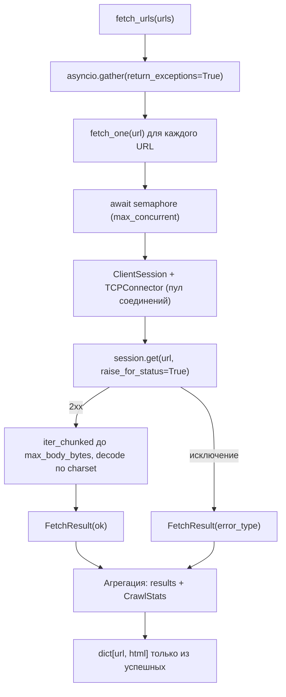

# Алгоритм: День 1 — базовый асинхронный HTTP-клиент

## Общая схема

## Пошагово

1. `fetch_urls` создаёт по корутине `fetch_one` на каждый URL и отдаёт их в
   `asyncio.gather(return_exceptions=True)`. Флаг важен: без него первое же
   исключение отменило бы остальные задачи.
2. Внутри `fetch_one` корутина ждёт `asyncio.Semaphore`. Семафор ограничивает
   число *одновременных запросов*, а не число созданных задач: все задачи
   стартуют сразу, но в сеть уходит не больше `max_concurrent`.
3. Сессия создаётся лениво, при первом запросе. Так объект `AsyncCrawler` можно
   создать вне работающего event loop — `TCPConnector` привяжется к тому циклу,
   в котором реально выполняются запросы.
4. Тело читается циклом `iter_chunked` с ограничением `max_body_bytes`, чтобы
   одна гигантская страница не съела память. При достижении лимита результат
   помечается флагом `truncated`.
5. Все результаты (и успешные, и ошибочные) складываются в `self.results`, по
   ним считается `CrawlStats`. В возвращаемый словарь попадают только успешные.

Повторяющиеся URL отбрасываются перед запуском задач: краулеру незачем грузить
одну страницу дважды, и благодаря этому `len(результат)` совпадает со
`stats.succeeded`.

## Чтение тела и кодировка: две ловушки aiohttp

`response.content.read(n)` выглядит как «прочитать до n байт», но на деле он
ждёт лишь появления данных в буфере и возвращает `_read_nowait(n)` — то, что уже
пришло. Ответ, доставленный несколькими TCP-чанками, обрезался бы до первого
чанка, причём молча: `FetchResult.ok` остался бы `True`. Поэтому тело читается
циклом `async for chunk in response.content.iter_chunked(CHUNK_SIZE)`.

`response.get_encoding()` при отсутствии `charset` в `Content-Type` переходит к
определению кодировки по содержимому и требует, чтобы тело уже лежало в
`response._body`. При чтении через `response.content` его там нет, и метод
бросает `RuntimeError: Cannot compute fallback encoding of a not yet read body` —
валидная страница превратилась бы в ошибку `unknown`. Берём `response.charset`
(только заголовок, исключений не бросает) с фолбэком на `utf-8`, а на случай
нераспознанного имени кодека ловим `LookupError`.

## Семантика `elapsed`

`FetchResult.elapsed` отсчитывается после захвата семафора, то есть это время
самого запроса без ожидания в очереди. Иначе при `max_concurrent=5` и восьми URL
последние запросы показывали бы время вместе с ожиданием и выглядели бы
аномально медленными. Общее время батча живёт отдельно — в `CrawlStats.elapsed`.

## Пул соединений и таймауты

| Параметр | Значение по умолчанию | Зачем |
| --- | --- | --- |
| `limit` | `max_concurrent * 2` | общий размер пула TCP-соединений |
| `limit_per_host` | `max_concurrent` | не бомбить один хост сверх лимита |
| `ttl_dns_cache` | 300 с | не резолвить DNS на каждый запрос |
| `timeout_connect` | 5 с | отсечь мёртвые хосты на этапе соединения |
| `timeout_read` | 10 с | защита от «тихого» сервера, который держит соединение |
| `timeout_total` | 15 с | жёсткий потолок на весь запрос |

Три таймаута работают вместе: `connect` и `sock_read` ловят типичные зависания
на конкретных этапах, `total` гарантирует, что запрос не живёт вечно даже если
сервер отдаёт данные по одному байту.

SSL-контекст строится из корневых сертификатов `certifi`. Системное хранилище CA
доступно не на всех машинах (в свежем venv на macOS его обычно нет), и тогда все
https-запросы падают с `CERTIFICATE_VERIFY_FAILED`. Свой контекст можно передать
через аргумент `ssl_context`.

## Обработка исключений

Порядок `except` важен: `ClientResponseError` — подкласс `ClientError`, поэтому
проверяется первым, иначе HTTP-ошибки попали бы в категорию сетевых.

| Исключение | `error_type` | Пример |
| --- | --- | --- |
| `asyncio.TimeoutError` | `timeout` | сервер не ответил за отведённое время |
| `aiohttp.ClientResponseError` | `http` | 404, 500 (включается `raise_for_status`) |
| `aiohttp.ClientError` | `network` | DNS не разрешился, соединение сброшено |
| любое другое `Exception` | `unknown` | неожиданная ошибка в разборе ответа |

`asyncio.CancelledError` перебрасывается наружу, а не превращается в
`FetchResult`: отмена задачи — это управляющий сигнал, а не ошибка загрузки.

## Два контракта возврата

- `fetch_one(url) -> FetchResult` — никогда не поднимает исключение, удобен для
  массовой загрузки и статистики.
- `fetch_url(url) -> str` — возвращает текст страницы либо поднимает
  `FetchError` с вложенным `FetchResult`. Такой API требует задание, и он удобен,
  когда загрузка одной страницы критична для дальнейшей логики.

## Почему параллельная загрузка быстрее

Сетевой запрос почти всё время ждёт ответа, а не считает. На ожидании корутина
отдаёт управление event loop, и тот запускает следующий запрос. Для N страниц с
задержкой d последовательное время примерно `N * d`, параллельное —
`ceil(N / max_concurrent) * d`. Это и проверяет тест
`test_parallel_is_faster_than_sequential`.
