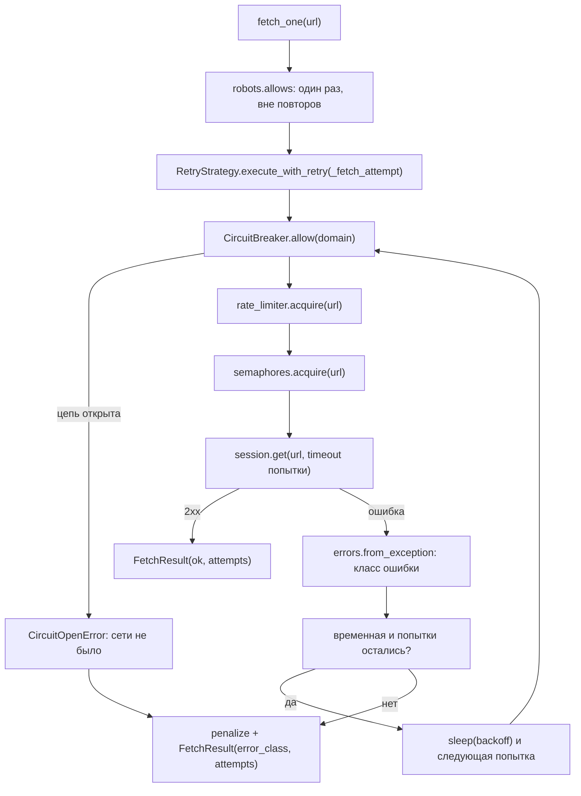
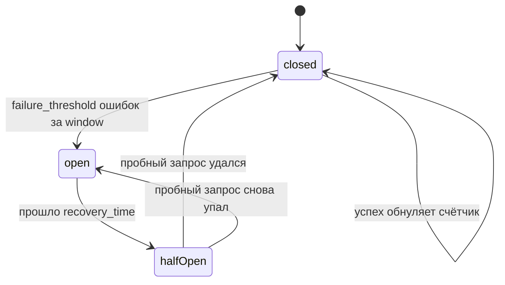

# Алгоритм: День 5 — обработка ошибок и автоматические повторы

## Где повторы вклиниваются в запрос



Два решения задают всю схему.

**robots.txt спрашивается вне цикла повторов.** Его ответ от попытки к попытке
не меняется, а каждая проверка попадала бы в статистику и раздувала счётчики.

**Пауза между попытками одного URL — дело `RetryStrategy`, пауза между разными
URL — дело `RateLimiter`.** Поэтому штраф домену (`penalize`) ставится один раз,
по итогу всех попыток: наказывать за каждую означало бы разгонять задержку
домена в геометрической прогрессии из-за одной битой страницы. При этом паузы
не складываются — лимитер считает шаг от времени последнего запроса, поэтому
фактическая пауза перед повтором равна большей из двух:

```
повтор ждёт 0.5 с, шаг лимитера 2 с  ->  запрос уйдёт через 2 с
повтор ждёт 5 с,   шаг лимитера 1 с  ->  запрос уйдёт через 5 с
```

## Классификация ошибок

[../src/errors.py](../src/errors.py) отвечает на вопрос «повторять ли», а
строки `error_type` из дня 1 остаются как были — их печатают таблицы и на них
смотрят тесты. В `FetchResult` теперь два поля: `error_type` (что произошло) и
`error_class` (что с этим делать).

| Ответ или исключение | Класс | `error_type` | Повтор |
| --- | --- | --- | --- |
| 429 Too Many Requests | `RateLimitError` | `http` | да, с увеличенной паузой |
| 500, 502, 503, 504 | `ServerError` | `http` | да, ограниченное число раз |
| 408, 425 | `TransientError` | `http` | да |
| `asyncio.TimeoutError`, `ServerTimeoutError` | `CrawlerTimeoutError` | `timeout` | да, с ростом таймаута |
| `aiohttp.ClientError` (DNS, connection refused) | `NetworkError` | `network` | да |
| 400, 401, 403, 404, 410 и прочие 4xx | `PermanentError` | `http` | нет |
| отказ разбора страницы | `ParseError` | `parse` | нет |
| отказ circuit breaker'а | `CircuitOpenError` | `circuit` | нет |
| запрет robots.txt | `RobotsBlockedError` | `robots` | нет |
| любое другое исключение | `CrawlerError` | `unknown` | нет |

Порядок проверок в `from_exception` повторяет день 1 и важен: таймаут
проверяется первым, потому что `aiohttp.ServerTimeoutError` наследуется и от
`ClientError`, и от `asyncio.TimeoutError`; `ClientResponseError` — раньше
`ClientError`, иначе HTTP-ошибки попали бы в сетевые.

Имя `CrawlerTimeoutError`, а не `TimeoutError`: в Python 3.11 встроенный
`TimeoutError` — это и есть `asyncio.TimeoutError`, перекрывать его своим
классом нельзя.

`CancelledError` не перехватывается ни стратегией, ни краулером: отмена задачи —
управляющий сигнал, а не ошибка загрузки, и повторять её нечего.

`RobotsBlockedError` и `CircuitOpenError` как исключения не поднимаются —
краулер отказывает ещё до попытки, — но дают отказу имя класса. Иначе
сознательный отказ попадал бы в отчёт «неизвестной ошибкой» рядом с настоящими
сбоями.

## Политики повторов

Все временные ошибки повторять одинаково неправильно: 429 просит подождать нас,
5xx сообщает о поломке на своей стороне. Поэтому у типов разные лимиты и базовые
паузы (`max_retries` и `base_delay` — настройки краулера, по умолчанию 2 и 0.5 с):

| Класс | Повторов | База паузы | Почему так |
| --- | --- | --- | --- |
| `RateLimitError` | `max_retries + 1` | `max(base_delay, 5 с)` | сервер прямо сказал «позже» — стоит дать лишний шанс и подождать заметно дольше |
| `ServerError` | `max(1, max_retries - 1)` | `base_delay * 2` | 5xx чаще настоящая поломка, чем всплеск: долбить её незачем |
| `NetworkError` | `max_retries` | `base_delay * 2` | сеть восстанавливается не мгновенно |
| остальные временные | `max_retries` | `base_delay` | общий случай |
| `PermanentError`, `ParseError`, `CircuitOpenError` | 0 | — | ответ не изменится |

Политика ищется по иерархии классов (MRO исключения), поэтому неизвестный
подвид `TransientError` получает политику родителя, а не остаётся без повторов.
Свою политику можно передать аргументом `policies={ServerError: RetryPolicy(...)}`.

При `max_retries=0` политик нет вовсе: выключенные повторы не должны оживать
из-за того, что у 429 лимит на одну попытку больше.

## Экспоненциальный backoff

```
пауза(попытка) = min(base_delay * backoff_factor ** (попытка - 1), max_delay) + jitter
```

При настройках по умолчанию (`base_delay=0.5`, `backoff_factor=2.0`,
`max_retries=2`) это выглядит так:

| Ошибка | Паузы между попытками | Всего попыток |
| --- | --- | --- |
| таймаут, 408 | 0.5 с, 1.0 с | 3 |
| 503 | 1.0 с | 2 |
| сетевая | 1.0 с, 2.0 с | 3 |
| 429 | 5 с, 10 с, 20 с | 4 |

`jitter` добавляется только вверх: раньше срока повтор уходить не должен. По
умолчанию он нулевой, потому что паузы повторов и так разъезжаются по времени —
в отличие от стартового залпа, от которого защищает `jitter` лимитера.

### Retry-After

Заголовок `Retry-After` (секунды или HTTP-дата) читается из ответов 429 и 5xx и
не даёт уйти раньше, чем просит сервер, но и не сокращает наш backoff: берётся
большее из двух. Всё это ограничено `max_delay` — иначе один заголовок
«подождите час» остановил бы обход. Отрицательные и непонятные значения
игнорируются, прошедшая дата означает «уже можно», то есть ноль.

## Таймауты

У запроса три таймаута из дня 1 (`timeout_connect`, `timeout_read`,
`timeout_total`), и с каждой попыткой они растут в `timeout_growth` раз
(по умолчанию 1.5), но не выше `timeout_max_total`:

| Попытка | `total` при 15 с и росте 1.5 |
| --- | --- |
| 1 | 15 с |
| 2 | 22.5 с |
| 3 | 33.75 с |
| 6 | 60 с (потолок) |

Медленный сервер чаще перегружен, чем мёртв: повтор с тем же таймаутом упал бы
по той же причине, и попытка была бы потрачена зря. Первая попытка использует
таймаут сессии без изменений — `timeout_for_attempt(1)` возвращает тот же
объект, поэтому обычный запрос ничего не теряет.

Потолок только ограничивает рост и никогда не урезает исходный таймаут: у
краулера с `timeout_total=120` при потолке 60 повтор получил бы вдвое меньше
времени, чем первая попытка, и падал бы там, где первая попытка успевала.

## Circuit breaker

[../src/circuit.py](../src/circuit.py) включается отдельно
(`circuit_breaker=True`): он отказывает в загрузке, не обращаясь в сеть, и такое
решение краулер не должен принимать молча.



- Ключ — тот же `domain_key`, что у лимитера и семафоров: `www` и порт одного
  сайта делят состояние, потому что защищаем мы сервер, а не адрес.
- В состоянии `open` запросы отвергаются с `CircuitOpenError`; в `half-open`
  проходит **один** пробный запрос, остальные ждут его исхода. Если исход так и
  не пришёл (задачу отменили), через `recovery_time` проба повторяется — иначе
  домен остался бы закрытым навсегда.
- Порог считает неудачные **запросы**, а не URL: три повтора одного адреса — три
  ошибки в окне. Этим breaker отличается от штрафа лимитеру, который ставится
  один раз по итогу всех попыток: лимитер замедляет темп, breaker ищет признаки
  аварии, и для него важна нагрузка на сервер, а не число битых страниц.
- Постоянные ошибки (404, 403) и ошибки разбора счётчик не растят: обход сайта с
  битыми ссылками не признак аварии сервера. Но на пробном запросе такой ответ
  цепь **закрывает**: сервер ответил — пусть и отказом, — значит, он жив. Иначе
  404 на пробе держал бы живой домен отключённым ещё `recovery_time`.
- Успешный ответ обнуляет счётчик ошибок, а не уменьшает: порог считается по
  скользящему окну `window`, и устаревшие ошибки из него и так выпадают.
- В статистике домены видны двумя списками: `open` и `half_open`. Домен с пробой
  в пути тоже никого не пускает, и пропадать из сводки на это время он не должен.

Проверка стоит внутри попытки, поэтому открывшаяся цепь обрывает и повторы: у
URL, чья первая попытка упала с 503, а вторая уже была отвергнута, итоговая
ошибка — `CircuitOpenError`. Исходная причина при этом видна в логе и в
`retry.by_class`, а в сеть лишний запрос не пошёл — ровно то, зачем breaker и
нужен.

## Статистика и отчёт об ошибках

`get_crawl_stats()` дополняется разделами `retry`, `circuit` и `errors`.

| Поле `retry` | Смысл |
| --- | --- |
| `calls`, `attempts`, `retries` | запросов, попыток и повторов |
| `retry_success` | сколько запросов спасли повторы — главная цифра дня |
| `exhausted`, `not_retried` | лимит кончился / тип не повторяется |
| `wait_total`, `avg_wait`, `max_wait` | сколько времени ушло на паузы |
| `by_class`, `by_error_type` | ошибки по классам и по типам дня 1 |
| `policies` | действующие лимиты и базы паузы по классам |

| Поле `errors` (`get_error_report()`) | Смысл |
| --- | --- |
| `total`, `failed` | результатов всего и неудачных |
| `by_type`, `by_class` | распределение ошибок |
| `retried_urls`, `retry_waited` | URL с повторами и суммарная пауза по ним |
| `permanent_count`, `permanent_urls` | постоянные ошибки: URL, статус, текст, попытки |

Отчёт считается из `self.results` — отдельного состояния для него нет, потому
что результаты и так хранят класс ошибки, число попыток и ожидание повторов.
`crawl()` сбрасывает счётчики повторов и breaker'а вместе с остальными, но не
состояние цепи: открытая цепь остаётся открытой, иначе второй обход снова пошёл
бы в упавший домен.

Каждая попытка пишется в лог: класс ошибки, URL, номер попытки и время до
следующей (`WARNING`), а итог — успех с N-й попытки (`INFO`) или исчерпание
повторов (`WARNING`). `FetchResult` и страница в результатах обхода несут
`attempts`, `error_class` и `retry_waited`, так что картину видно и без логов.

## Демонстрация

```bash
# адреса с разными ошибками: 503 и 500 повторяются, 404 и 403 — нет
python -m src.main --retry
python -m src.main --retry --no-retry                  # то же без повторов, для сравнения
python -m src.main --retry --max-retries 4 --retry-base-delay 1
python -m src.main --crawl --max-pages 6 --circuit-breaker --circuit-threshold 3
python -m src.main --crawl --timeout-total 5 --timeout-growth 2
```

Режим `--retry` печатает таблицу результатов с колонкой попыток, статистику
повторов, сводку по ошибкам и сохраняет отчёт в `data/errors_<время>.json`.

## Что осталось за рамками дня

- **Воркер занят, пока идут повторы.** URL уже вынут из очереди, и паузы между
  попытками воркер проводит в ожидании, не берясь за другую работу. Лечится
  возвратом URL в очередь с отложенным сроком — это очередь повторов, а не
  стратегия.
- **Отказ breaker'а тратит бюджет `max_pages`.** Запрос в сеть не уходит, но URL
  считается обработанным и попадает в неудачные. Пропускать его, как запрет
  robots.txt, значило бы крутить очередь мёртвого домена впустую.
- **`Retry-After` не становится постоянным `Crawl-delay`.** Заголовок влияет
  только на ближайшую паузу: требование сайта о темпе — это robots.txt, а не
  реакция на единичный всплеск.
- **Повторы не переживают запуск.** Исчерпавший попытки URL остаётся неудачным;
  сохранение очереди повторов между запусками — тема сохранения состояния.
- **Загрузка robots.txt не повторяется.** У неё своя обработка ошибок из дня 4:
  неудача кэшируется, и решение принимает `robots_allow_on_error`. Повторять
  запрос к сайту, которому и так плохо, ради файла правил незачем.
- **Редирект после ошибки не разбирается особо.** Повтор идёт на исходный URL;
  если сервер отвечает ошибкой только с одного адреса цепочки, краулер этого
  не различает.
