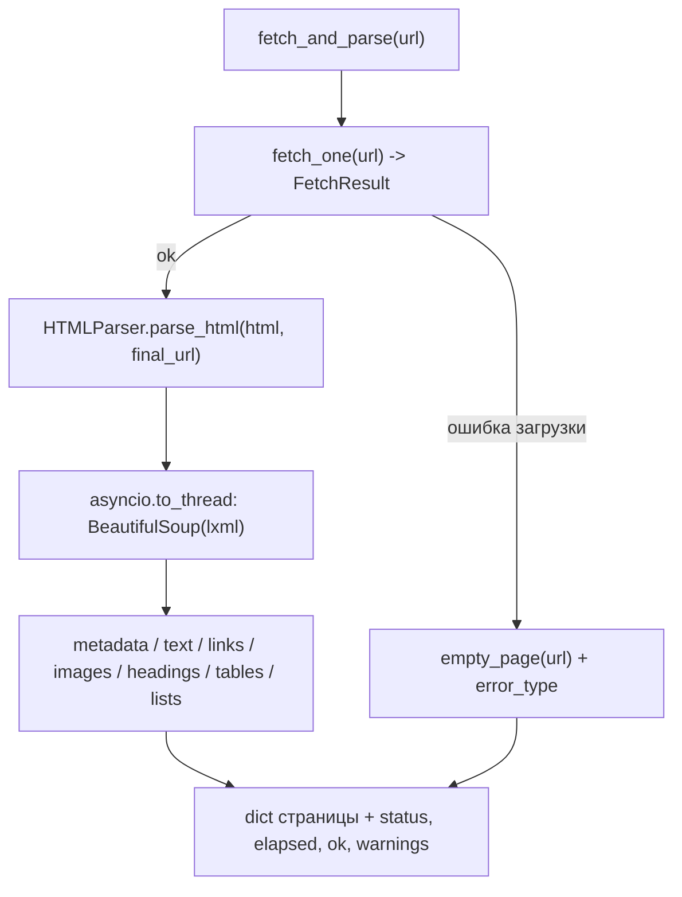

# Алгоритм: День 2 — парсинг HTML и извлечение данных

## Общая схема



## Почему разбор уходит в поток

`BeautifulSoup` — синхронный CPU-bound код: пока он строит дерево, event loop
стоит и не может обслуживать остальные запросы, хотя те просто ждут сеть.
Поэтому `parse_html` — корутина-обёртка над `asyncio.to_thread(self._parse_sync, ...)`.
Разбор освобождает GIL не полностью, но на время парсинга цикл продолжает
принимать данные из сокетов, и загрузка остальных страниц не замирает.

Побочная выгода: `parse_html` честно `async`, как требует задание, а не
корутина, которая на самом деле блокирует.

## Методы `HTMLParser`

| Метод | Возвращает | Особенности |
| --- | --- | --- |
| `parse_html(html, url)` | `dict` со всеми полями | async, разбор в отдельном потоке |
| `extract_links(soup, base_url)` | `list[str]` | абсолютные http(s) URL без повторов |
| `extract_text(soup, selector=None)` | `str` | текст без `script`/`style`/`noscript` |
| `extract_metadata(soup)` | `dict` | title, description, keywords, lang, canonical, og |
| `extract_images(soup, base_url)` | `list[dict]` | `src` (абсолютный) и `alt` |
| `extract_headings(soup)` | `dict[str, list[str]]` | ключи `h1`, `h2`, `h3` |
| `extract_tables(soup)` | `list[dict]` | `headers` + `rows` |
| `extract_lists(soup)` | `list[dict]` | `type` (`ul`/`ol`) + `items` |

Парсер выбирается в конструкторе (`lxml` по умолчанию). Если библиотека не
установлена, `BeautifulSoup` бросает `FeatureNotFound` — это проверяется один раз
при создании `HTMLParser`, и при недоступности включается встроенный
`html.parser` с предупреждением в лог, вместо падения на первой же странице.

## Ссылки: нормализация и валидация

```python
absolute, _fragment = urldefrag(urljoin(base_url, href))
```

1. База для `urljoin` — `<base href>` страницы, если он есть, иначе
   `FetchResult.final_url`, то есть URL **после редиректов**. Оба уточнения
   обязательны: без `<base>` неверно разрешатся ссылки на страницах, которые
   отдают контент с CDN, а без `final_url` — ссылки на странице, ответившей 301
   на другой каталог или домен.
2. Фрагмент отбрасывается: `/about` и `/about#top` — одна и та же страница.
   Ссылки, состоящие только из якоря (`href="#section"`), пропускаются совсем —
   это навигация внутри текущей страницы, а не новый URL.
3. Остаются только схемы `http` и `https` с непустым хостом. Так отсекаются
   `mailto:`, `tel:`, `javascript:` и `data:` — краулеру их не загрузить.
4. Повторы убираются через `dict.fromkeys`, порядок первого появления
   сохраняется: он отражает структуру страницы и пригодится при обходе.
5. `same_domain_only` (параметр конструктора или аргумент метода) оставляет
   только ссылки с хоста базового URL.

Изображения проходят ту же нормализацию `src`, но с одним исключением:
`data:`-источник сохраняется как есть. Это не ссылка, которую надо загружать, а
само изображение, и выбрасывать такую картинку из результата неправильно.

## Текст: почему дерево не изменяется

Типичный приём — `for tag in soup(["script", "style"]): tag.decompose()`. Но
`extract_text` получает то же дерево, с которым работают остальные извлечения,
и после `decompose()` они увидели бы искалеченный документ (порядок вызовов стал
бы неявной зависимостью). Поэтому текст собирается из `root.strings` с
пропуском строк, у которых среди `parents` есть шумный тег:

```python
chunks = [str(s) for root in roots for s in root.strings if not self._inside_noise(s)]
```

`.strings` в bs4 не отдаёт комментарии и содержимое `script`/`style`
(они представлены отдельными классами `Script`/`Stylesheet`), а фильтр по
`parents` дополнительно убирает `noscript` и `template` и не зависит от
выбранного парсера. Результат сжимается по пробелам одним `re.sub(r"\s+", " ")`.

Корень по умолчанию — `soup.body`, а не весь документ: иначе в «основной текст»
попадает содержимое `<title>` из `<head>`. Фолбэк на весь документ нужен для
фрагментов разметки, где `html.parser` тега `body` не создаёт.

Если `selector` задан, но ничего не нашёл — это предупреждение, а не ошибка:
текст берётся из `body`, чтобы страница не осталась без контента из-за одного
неподходящего селектора. Если же селектор совпал и с родителем, и с его
потомком, остаются только верхние совпадения: иначе текст вложенного блока
попал бы в результат дважды.

## Таблицы и списки: рекурсивность `find_all`

`find_all` обходит всё поддерево, поэтому для вложенной таблицы её строки и
ячейки оказались бы и в результате внешней таблицы (одна строка внешней
превращалась в две, причём с текстом вложенной). Поэтому строки фильтруются по
ближайшей таблице, а ячейки берутся только прямые:

```python
own_rows = [row for row in table.find_all("tr") if row.find_parent("table") is table]
cells = row.find_all(["th", "td"], recursive=False)
```

Вложенная таблица при этом попадает в результат отдельным элементом. По той же
причине `extract_lists` берёт `find_all("li", recursive=False)`, и вложенный
`ul`/`ol` тоже становится отдельной записью.

## Частичные результаты вместо исключений

Каждое извлечение вызывается через обёртку:

```python
metadata = self._safe("metadata", notes, {}, self.extract_metadata, soup)
```

`_safe` ловит `Exception`, пишет предупреждение в лог и в список
`page["warnings"]`, а в поле подставляет пустое значение. Сбой разбора таблицы
не отменяет уже извлечённые title, текст и ссылки — страница возвращается
частично заполненной. Если дерево не удалось построить вообще, возвращается
`empty_page(url)` с одной записью в `warnings`.

Битый HTML (незакрытые теги, мусор после `</body>`, пустое тело) для lxml —
рабочая ситуация, он восстанавливает дерево сам.

## MarkupResemblesLocatorWarning и потоки

bs4 принимает короткий ответ без тегов и переводов строки (до 256 символов) за
путь к файлу или URL и предупреждает об этом. Для краулера это обычный мусорный
ответ, так что предупреждение глушится — но **не** через
`warnings.catch_warnings` внутри `make_soup`, как это делалось сначала.

`catch_warnings` сохраняет и восстанавливает глобальный список
`warnings.filters` и не потокобезопасен, а разбор идёт в `asyncio.to_thread`,
то есть в нескольких потоках одновременно. Потоки затирали фильтры друг друга и
фильтры приложения: проверка на 8 параллельных разборах показала потерю
пользовательского фильтра в 1 случае из 200. Поэтому фильтр ставится один раз
при импорте модуля — идемпотентно и без гонок:

```python
warnings.filterwarnings("ignore", category=MarkupResemblesLocatorWarning)
```

У глобального фильтра есть обратная сторона: приложение может объявить
предупреждения ошибками (`python -W error`), и тогда наш `ignore` перекрыт, а
конструктор `BeautifulSoup` бросает исключение вместо предупреждения. Терять
из-за этого страницу незачем — bs4 ругается только на текст без тегов, то есть
разметки там и нет, поэтому `make_soup` ловит такое исключение и оборачивает
ответ в минимальный документ:

```python
except MarkupResemblesLocatorWarning:
    return BeautifulSoup(f"<html><body>{escape(html)}</body></html>", self.parser)
```

## Форма результата

`parse_html` возвращает плоский словарь: `url`, `title`, `text`, `text_length`,
`links`, `links_count`, `images`, `images_count`, `headings`, `tables`, `lists`,
`metadata`, `warnings`. `fetch_and_parse` добавляет к нему данные загрузки:
`final_url`, `status`, `elapsed`, `truncated`, `ok`, `error`, `error_type`.

Ключи одинаковы и при успехе, и при ошибке загрузки — при неудаче коллекции
просто пустые. Вызывающий код проверяет один флаг `ok` и не рискует получить
`KeyError` на ветке с ошибкой.

`fetch_and_parse_many` работает поверх `_fetch_and_parse`, который отдаёт пару
`(FetchResult, dict)`: словарь уходит вызывающему, а `FetchResult` остаётся для
`self.results` и `CrawlStats`. Дедупликация URL и
`asyncio.gather(return_exceptions=True)` — те же, что в `fetch_urls` дня 1.
