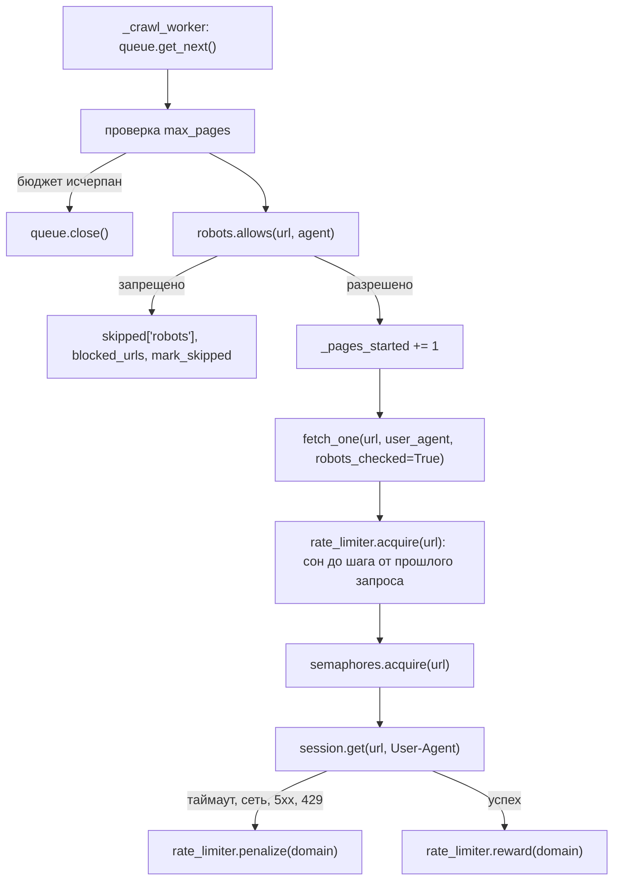

# Алгоритм: День 4 — rate limiting и правила вежливости

## Где вежливость вклинивается в запрос



Порядок выбран не случайно:

1. **robots.txt — первым.** Решение не требует сети (кроме одной загрузки на
   сервер), поэтому запрещённый URL отваливается до всех лимитов. В воркере
   проверка стоит ещё и **до** инкремента `max_pages`: запрет robots.txt не
   должен тратить бюджет страниц и попадать в `failed_urls` — это не ошибка
   загрузки, а сознательный отказ. Но если бюджет уже исчерпан, воркер выходит
   не спросив: URL, который никто не собирался грузить, незачем тащить в
   статистику проверок и в `blocked_urls`.
2. **Лимитер — перед семафорами.** Ожидающая задача не держит слот
   конкурентности. В обратном порядке краулер с `max_concurrent=5` и лимитом
   1 зап/с на домен застрял бы: пять задач спали бы, занимая все слоты, и
   запросы к другим доменам стояли бы в стороне без причины.
3. **Семафоры — последними**, вплотную к самому запросу: они ограничивают,
   сколько соединений открыто одновременно.

Лимитер и семафоры отвечают за разное и не заменяют друг друга: семафор говорит
«не больше трёх запросов к домену одновременно», лимитер — «не чаще двух
запросов в секунду». Один медленный ответ не даёт права отправить следующий
запрос немедленно, и наоборот.

## RateLimiter: шаг вместо вёдра токенов

[../src/ratelimit.py](../src/ratelimit.py) хранит на каждый ключ (домен или
общий `*`) время последнего разрешённого запроса; следующий уходит не раньше
чем через шаг после него:

```python
async with self._lock_for(key):          # честная очередь asyncio.Lock
    now = time.monotonic()
    last = self._last_allowed.get(key)
    if last is not None:
        wait = last + self._delay(domain) - now   # шаг считается здесь и сейчас
        if wait > 0:
            await asyncio.sleep(wait)
            now = time.monotonic()
    self._last_allowed[key] = now
```

Три решения в этих строках:

- **Ожидание под локом.** `asyncio.Lock` выдаёт себя в порядке очереди, поэтому
  запросы уходят в том же порядке, в котором их попросили, и ровно по шагу. Без
  лока все ожидающие проснулись бы по одному и тому же сроку и ушли бы разом —
  то есть всплеском, от которого лимит и должен защищать.
- **Шаг, а не токены.** «Ведро токенов» разрешает накопить паузу и выпустить
  пачку запросов сразу; для вежливости это худший вариант. Поэтому разрешения
  выдаются равномерно, и всплеска не бывает даже в начале обхода.
- **Хранится прошлое, а не будущее.** Удобнее было бы в конце `acquire`
  записать «следующий запрос не раньше чем в `now + шаг`», но тогда шаг
  фиксировался бы раньше, чем мы узнаём новые требования. `Crawl-delay`
  появляется сразу после загрузки robots.txt, штраф — сразу после ошибки, и оба
  вступили бы в силу только через запрос: первая страница сайта с
  `Crawl-delay: 30` ушла бы без паузы. Поэтому хранится время последнего
  запроса, а шаг считается в момент ожидания.

Эффективная задержка складывается так:

| Слагаемое | Откуда | Как участвует |
| --- | --- | --- |
| `1 / requests_per_second` | настройка краулера | берётся максимум |
| `min_delay` | настройка краулера | берётся максимум |
| `Crawl-delay` | robots.txt домена | берётся максимум |
| `backoff` | штраф после ошибок | прибавляется сверху |
| `jitter` | `random.uniform(0, jitter)` | прибавляется сверху |

Максимум — потому что это три формулировки одного требования «не чаще, чем»;
побеждает самая строгая. Штраф и разброс именно прибавляются: они не
альтернатива лимиту, а наказание и маскировка поверх него. Разброс всегда
только вверх — запрос не должен уйти раньше, чем разрешил лимит.
`interval_for()` показывает шаг без разброса, поэтому его можно проверять в
тестах.

Ключ домена считается тем же `domain_key`, что в фильтрах и семафорах, так что
`example.com`, `www.example.com` и `example.com:443` делят один лимит. При
`per_domain=False` все домены получают один общий ключ `*` — удобно, когда
ограничен собственный канал, а не вежливость к конкретному сайту.

Ключей при этом два, и это важно. Темп (`_last_allowed`, локи) живёт по
`per_domain`, а `Crawl-delay` и штраф — **всегда по сайту**: это свойства сайта,
а не нашего канала. Иначе в режиме общего лимита `Crawl-delay: 30` одного
медленного сервера записался бы под ключ `*` и растянул обход всех остальных, а
ошибка одного сайта наказывала бы здоровые. Общие часы — да, чужие задержки —
нет.

Локи удаляются по счётчику ссылок (как `_host_refs` в `SemaphoreManager`), а
время последнего запроса остаётся: иначе пауза между двумя последовательными
запросами к домену обнулялась бы ровно в тот момент, когда она нужна.

## Backoff: замедление, а не повтор

`penalize(domain)` после ошибки увеличивает штраф домена: первая ошибка стоит
`backoff_start`, каждая следующая — в `backoff_factor` раз дороже, но не больше
`max_backoff`. `reward(domain)` после успеха уменьшает штраф **вдвое**, а не
обнуляет: один удачный ответ после серии ошибок ещё не значит, что сайт
восстановился.

Замедляемся не от любой ошибки, а только от похожей на перегрузку: таймаут,
сетевой сбой, 5xx, 408 и 429. Обычный 404 к скорости отношения не имеет — иначе
сайт с битыми ссылками тормозил бы обход без причины.

Повторной загрузки URL здесь нет: `mark_failed` по-прежнему закрывает URL
окончательно, краулер лишь перестаёт давить на сайт, которому плохо. Политика
повторов (очередь retry, лимит попыток) — тема дня 5.

## robots.txt: свой парсер и почему не стандартный

`urllib.robotparser` из стандартной библиотеки сравнивает пути только по
префиксу. Реальные robots.txt полны шаблонов вроде `Disallow: /*?` и
`Disallow: /*.pdf$`, и такой парсер их молча пропустит, то есть разрешит то, что
запрещено. Поэтому [../src/robots.py](../src/robots.py) разбирает файл сам.

Правила разбора:

- **Группы.** Подряд идущие строки `User-agent` образуют одну группу: следующие
  за ними `Allow`/`Disallow`/`Crawl-delay` относятся ко всем перечисленным
  агентам. Первое правило закрывает перечисление, и очередной `User-agent`
  начинает новую группу.
- **Выбор группы.** Сравнивается не весь User-Agent, а только имя продукта —
  текст до первого `/`. Для `AsyncCrawler/1.0 (+https://example.com/bot)` это
  `asynccrawler`, поэтому группа `User-agent: bot` нас не касается. Если
  сравнивать всю строку, любое слово из ссылки или комментария случайно
  совпадало бы с чьим-то именем, и `Disallow: /` чужой группы закрыл бы весь
  сайт. Из подошедших по префиксу групп берётся самая длинная: для
  `Googlebot-News/1.0` точнее `googlebot-news`, чем `googlebot`. Если не подошла
  ни одна — работает группа `*`, а если нет и её, правил нет вовсе. Группа
  агента **заменяет** `*`, а не дополняет её: так устроен формат.
- **Шаблоны.** `*` — любая подстрока, `$` на конце — конец адреса, начало пути
  всегда закреплено. Остальные символы экранируются, поэтому `Disallow: /a+b(c)`
  не превращается в регулярное выражение.
- **Решение.** Из всех совпавших правил побеждает самое длинное, при равной
  длине — разрешающее (спецификация Google). Правила сравниваются с `путь +
  "?" + запрос`, поэтому `Disallow: /*?` действительно отсекает адреса с
  параметрами. Путь берётся через `urlsplit`, а не `urlparse`: последний
  отрезает `;params` последнего сегмента в отдельное поле, и `/page;sessionid=7`
  дошёл бы до правил как `/page`, мимо `Disallow: /*;sessionid`. Пустое значение
  (`Disallow:`) ничего не ограничивает.
- **Регистр.** Имена директив и агентов — без учёта регистра, пути — с учётом:
  `/Private` и `/private` на большинстве серверов разные адреса.

Недоступный robots.txt трактуется так:

| Ответ | Поведение | Почему |
| --- | --- | --- |
| 2xx | правила применяются | обычный случай |
| 4xx, кроме 429 | разрешено всё | файла нет — запретов нет, это норма для малых сайтов |
| 429 | `allow_on_error` | «слишком часто» — это не «файла нет»: правила существуют, мы их просто не получили |
| 5xx, таймаут, сетевая ошибка | `allow_on_error` (по умолчанию разрешить) | строгое чтение спецификации требует считать сайт закрытым, но тогда одна неудачная загрузка остановила бы весь обход; сайт, которому это важно, уважается флагом `robots_allow_on_error=False` |

Загрузка кэшируется по **origin** — схеме, хосту и порту (`origin_key` из
[../src/filters.py](../src/filters.py)), а не по домену. robots.txt принадлежит
серверу: `host:8001` и `host:8002` — разные сервисы со своими правилами, и
общий кэш по домену заставил бы один из них жить по правилам другого. Порт по
умолчанию (`:80` для http, `:443` для https) при этом отбрасывается, чтобы
`http://example.com` и `http://example.com:80` остались одним сервером. Лимит
скорости, наоборот, остаётся по домену: канал к хосту один.

Кэш наполняется под локом origin: четыре воркера, одновременно наткнувшиеся на
новый сайт, вызовут ровно одну загрузку robots.txt, а остальные дождутся
результата. Сам robots.txt запрашивается мимо проверки robots.txt (иначе вышла
бы рекурсия), но через лимитер и семафоры — это тоже запрос к сайту. Тело
читается не более `ROBOTS_MAX_BYTES`.

`Crawl-delay` после разбора переносится в лимитер
(`rate_limiter.set_crawl_delay`), поэтому задержка из robots.txt соблюдается тем
же механизмом, что и собственный лимит.

## User-Agent и ротация

| Параметр | Смысл |
| --- | --- |
| `user_agent` | основной агент: уходит в запросы, в загрузку robots.txt и служит ключом правил по умолчанию |
| `user_agents` | список для ротации по кругу; пустой означает «всегда основной» |

Агент выбирается **до** проверки robots.txt и передаётся в запрос, поэтому
страница проверяется и грузится под одним и тем же именем. Иначе ротация
превратилась бы в способ обойти правила: спросили разрешение за одного агента,
пришли под другим.

## Статистика

`get_crawl_stats()` дополняется двумя разделами.

| Поле `rate_limit` | Смысл |
| --- | --- |
| `requests`, `actual_rps` | сколько разрешений выдано и с какой фактической скоростью |
| `waited_total`, `avg_wait`, `max_wait` | сколько суммарно, в среднем и максимально ждали в лимитере |
| `avg_gap` | средний фактический промежуток между запросами к одному ключу (включает время самого запроса) |
| `penalties`, `backoff` | сколько раз замедлялись и какой штраф у доменов сейчас |
| `interval_by_domain` | текущий шаг по каждому ключу темпа; при общем лимите это одна строка, в выводе названная «все домены» |
| `enabled` | может ли лимитер вообще задержать запрос |

| Поле `robots` | Смысл |
| --- | --- |
| `checks`, `blocked`, `allowed` | сколько проверок сделано и чем закончились |
| `blocked_by_domain` | запреты по доменам |
| `fetched`, `missing`, `errors` | загружено файлов, отсутствует, не удалось получить |
| `crawl_delays` | `Crawl-delay` по доменам для текущего агента |

Запрещённые URL попадают в `AsyncCrawler.blocked_urls` (URL -> сработавшее
правило) и в `skipped["robots"]`, а каждый запрет пишется в лог на уровне INFO
вместе с правилом, группой и агентом — видно, почему именно страницу не обошли.

`crawl()` сбрасывает счётчики лимитера и парсера (`reset_stats`), но не само
состояние вежливости: разобранные правила, шаг задержек и штрафы остаются.
Забыть их означало бы на каждом обходе заново разгоняться до лимита и заново
грузить robots.txt.

Строка прогресса получает `ожидание:` и `robots:` только когда вежливость
включена: иначе для дней 1-3 она обросла бы нулями, которые ничего не значат.

## Методы и сигнатуры

| Метод | Возвращает | Назначение |
| --- | --- | --- |
| `RateLimiter.acquire(domain=None)` | `float` | ждёт разрешения, отдаёт время ожидания |
| `RateLimiter.interval_for(domain=None)` | `float` | текущий шаг без разброса |
| `RateLimiter.set_crawl_delay(domain, delay)` | — | задержка из robots.txt |
| `RateLimiter.penalize(domain)` / `reward(domain)` | `float` / — | замедлить после ошибки / ослабить штраф |
| `RateLimiter.get_stats()` / `reset_stats()` | `dict` / — | статистика ожиданий |
| `RobotsParser.fetch_robots(base_url)` | `dict` | загрузить robots.txt сервера и получить сводку |
| `RobotsParser.can_fetch(url, user_agent="*")` | `bool` | решение по уже загруженным правилам |
| `RobotsParser.cached_rules(url)` | `RobotsRules \| None` | правила сервера из кэша, без загрузки |
| `RobotsParser.allows(url, user_agent=None)` | `(bool, str \| None)` | решение с загрузкой и сработавшим правилом |
| `RobotsParser.get_crawl_delay(user_agent="*", url=None)` | `float` | `Crawl-delay` для агента |
| `parse_robots(text, status=None)` | `RobotsRules` | разбор без сети |
| `format_rate_stats(stats)` / `format_robots_stats(stats)` | `str` | блоки сводки для вывода |

## Демонстрация

```bash
# таблица решений robots.txt без обхода: видно и запреты, и отсутствие файла
python -m src.main --robots
python -m src.main --robots --user-agent HTTrack        # этому агенту python.org закрыт целиком

# обход с robots.txt, лимитом 2 зап/с и паузой 0.5 с
python -m src.main --polite --max-pages 8 --same-domain

# то же вручную, с разбросом и общим лимитом на все домены
python -m src.main --crawl --respect-robots --rps 1 --jitter 0.3 --global-rate
python -m src.main --crawl --rotate-ua "BotA/1.0" "BotB/1.0" --rps 2
```

## Что осталось за рамками дня

- **Редирект на запрещённый адрес.** Решение принимается до загрузки, а о том,
  куда сервер перенаправит, известно только после. Конечный URL не
  перепроверяется.
- **Воркер, ждущий медленный домен, не берёт другую работу.** Он уже вынул URL
  из очереди и спит в лимитере. При обходе нескольких доменов с разными
  `Crawl-delay` это заметно: самый медленный сайт способен занять все воркеры,
  пока другим доменам нечего ждать. Лечится не лимитером, а очередью: отдельной
  на каждый домен или выдающей тот URL, который уже готов к отправке.
- **Имя агента сравнивается по префиксу.** Группа `User-agent: async` подошла бы
  агенту `AsyncCrawler/1.0`. Так требует формат (`Googlebot` должен ловить
  `Googlebot-News`), но означает, что слишком короткое имя группы захватывает
  чужих. Выбор самой длинной подошедшей группы ограничивает ущерб, но не снимает
  его полностью.
- **Неудачная загрузка robots.txt кэшируется без срока жизни.** Если сайт
  ответил 503 один раз, правила не перезапрашиваются до конца обхода. Для
  одного запуска это осознанный компромисс в пользу предсказуемости.
- **Повторы запросов.** Backoff только замедляет; очередь повторов — тема дня 5.
