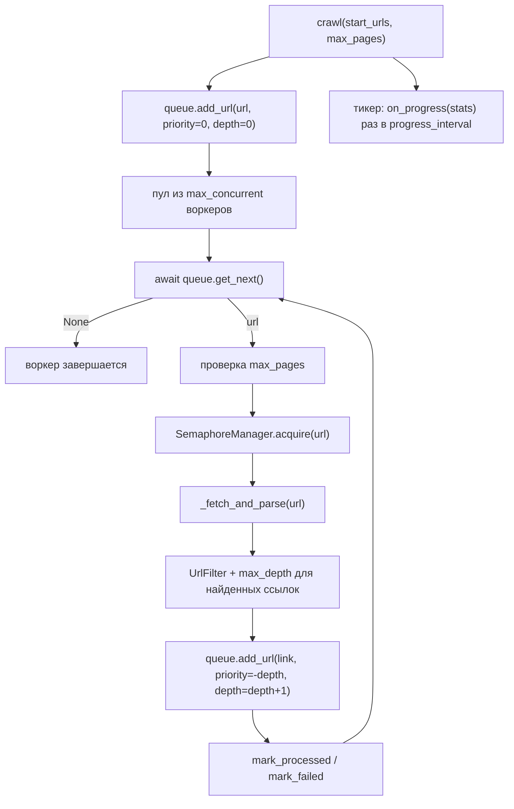

# Алгоритм: День 3 — очередь, конкурентность и обход сайта

## Общая схема



## Почему пул воркеров, а не обход волнами

Очевидная альтернатива — грузить уровень целиком через `fetch_and_parse_many`,
собирать ссылки и переходить на следующий уровень. Но тогда в конце каждого
уровня все воркеры простаивают, ожидая самую медленную страницу, а приоритеты
теряют смысл: внутри волны порядок всё равно не важен.

Поэтому обход делает пул из `max_concurrent` одинаковых воркеров: каждый берёт
URL из очереди, обрабатывает и возвращается за следующим. Уровни при этом всё
равно разбираются примерно по порядку, потому что ссылка попадает в очередь с
приоритетом `-глубина` — меньшая глубина выдаётся раньше.

## Протокол завершения очереди

Самое тонкое место дня. Пустая очередь ещё не означает конец работы: страницы,
которые сейчас загружаются, могут принести новые ссылки. Значит, воркер должен
получить `None` только тогда, когда очередь пуста **и** ни один URL не
обрабатывается.

```python
async def get_next(self) -> str | None:
    while True:
        if self._closed:
            return None
        if self._heap:
            return self._take()          # _in_progress += 1
        if self._in_progress == 0:
            self.close()                 # терминальное состояние «залипает»
            return None
        self._wakeup.clear()             # очередь пуста именно сейчас
        await self._wakeup.wait()
```

`add_url`, `mark_processed`, `mark_failed`, `mark_skipped` и `close` вызывают
`_wakeup.set()`. Два неочевидных свойства, без которых обход зависает:

1. **Между `clear()` и `wait()` нет точки переключения.** `clear` выполняется
   только когда очередь действительно пуста, а передать управление другой
   задаче между этими строками asyncio не может — значит, нельзя «потерять»
   пробуждение от URL, добавленного в этот момент.
2. **`close()` оставляет событие установленным навсегда.** Иначе так: последний
   `mark_processed` будит одного ожидающего, тот видит терминальное состояние,
   забирает `None` и сбрасывает событие — а остальные воркеры остаются спать
   вечно. На это есть отдельный тест
   (`test_all_waiting_workers_get_none_when_drained`).

Порядок действий в воркере тоже важен: ссылки ставятся в очередь **до**
`mark_processed`. При обратном порядке последний работающий воркер на мгновение
создал бы состояние «очередь пуста, все свободны», и остальные воркеры успели бы
выйти, не дождавшись новых URL.

## Приоритеты и дедупликация

Очередь — бинарная куча из кортежей `(-priority, counter, url)`:

- знак минус, потому что `heapq` отдаёт минимальный элемент, а приоритет выше
  должен выдаваться раньше;
- `counter` — монотонный счётчик: он ломает ничьи (FIFO внутри одного
  приоритета) и попутно избавляет от сравнения самих URL.

Дедупликация живёт в очереди: множество `seen` хранит все URL, когда-либо
добавленные, и `add_url` возвращает `False` для повтора. Поэтому воркерам не
нужно сверяться между собой, а цикл `/site/a -> /site/` не приводит к повторной
загрузке.

Повторов для неудачных URL в дне 3 нет: `mark_failed` закрывает URL
окончательно. Политика повторов — тема дня 5; день 4 добавляет только
замедление домена после ошибок (см. [politeness.md](politeness.md)).

## Один адрес страницы: нормализация и редиректы

Множества `seen` недостаточно: один и тот же документ легко попадает в очередь
под разными адресами. Поэтому все URL — и стартовые, и найденные — проходят
через `normalize_url` из [../src/filters.py](../src/filters.py):

| Что делается | Пример |
| --- | --- |
| схема и хост в нижний регистр | `HTTP://Example.COM/a` -> `http://example.com/a` |
| порт по умолчанию отбрасывается | `https://example.com:443/a` -> `https://example.com/a` |
| пустой путь становится `/` | `https://example.com` -> `https://example.com/` |
| пустой запрос и фрагмент отбрасываются | `/page?` и `/page#top` -> `/page` |

Путь и запрос по регистру **не** меняются: на большинстве серверов они
регистрозависимы, и `/About` — не то же самое, что `/about`.

Редиректы — отдельный случай: адрес, с которого страницу реально отдали,
известен только после загрузки. Поэтому нормализованный `final_url` попадает
в два места:

1. `queue.add_alias(final_url)` — цель запоминается как уже известная, но в
   очередь не ставится, поэтому более поздняя ссылка на неё игнорируется;
2. `AsyncCrawler._final_urls` — воркер сверяется с этим набором сразу после
   `get_next()` и пропускает URL (`mark_skipped`), если такую страницу уже
   загружали под другим адресом.

Неизбежным остаётся только одновременный случай: если ссылка на цель и сам
редирект загружаются в один момент, узнать о совпадении заранее нельзя, и
сервер отдаст страницу дважды.

## Два лимита конкурентности

`SemaphoreManager` пропускает каждый запрос через два семафора:

| Лимит | Зачем |
| --- | --- |
| `max_concurrent` | защита собственных ресурсов: сокеты, память, CPU на парсинг |
| `max_per_domain` | вежливость к сайту: не заваливать один хост запросами |

Слот домена берётся **первым**, общий — вторым. Взаимоблокировки нет при любом
порядке, пока он везде одинаков, но обратный вариант вреден: задача, ждущая
свободный слот своего домена, держала бы общий слот и зря не пускала запросы к
другим доменам (head-of-line blocking).

Домен определяется тем же `domain_key`, что и в фильтрах. Это важно: с «сырым»
`netloc` один сайт, доступный как `example.com`, `www.example.com` и
`example.com:443`, получил бы три отдельных семафора и втрое больший лимит
вежливости. Семафор домена удаляется, когда на него не осталось ни активных, ни
ожидающих задач (счётчик ссылок растёт до первого `await`, поэтому забрать
семафор из-под работающей задачи невозможно) — иначе словарь копил бы по
семафору на каждый встреченный за обход хост.

`max_per_domain=None` означает «как `max_concurrent`», то есть отдельного
ограничения на домен нет — это поведение дней 1-2. `TCPConnector` создаётся с
`limit_per_host=max_per_domain`, чтобы пул соединений не оказался уже семафора и
не он определял реальную конкурентность.

Менеджер считает активные задачи (`active_total`, `active_by_host`) и пики
(`peak_total`, `peak_by_host`); освобождение слота и уменьшение счётчиков — в
`finally`, иначе отменённая задача навсегда оставила бы счётчик завышенным.

## Глубина, фильтры и лимит страниц

- **Глубина.** Стартовые URL — глубина 0. Ссылка со страницы глубины `d`
  получает `d + 1`; если это больше `max_depth`, ссылка не ставится в очередь, а
  счётчик `skipped["depth"]` растёт. Глубина каждого URL хранится в очереди
  (`depths`) и попадает в данные страницы полем `depth`. В статистике различаются
  `max_depth_reached` — глубина **пройденных** страниц, и `max_depth_queued` —
  глубина всего, что попало в очередь, включая так и не загруженное.
- **Фильтры** (`UrlFilter` в [../src/filters.py](../src/filters.py)) проверяют
  ссылку в таком порядке: схема (только `http`/`https` с непустым хостом) ->
  домен (`same_domain_only`) -> `exclude_patterns` -> `include_patterns`. Запрет
  сильнее разрешения: «не ходить в `/logout`» работает даже если URL подошёл под
  include-паттерн. Домены сравниваются по ключу без схемы, порта и префикса
  `www.`, иначе обход `example.com` терял бы половину сайта.
- Фильтр влияет **только на очередь**. Ссылки в данных страницы остаются
  полными, включая внешние — поэтому в режиме обхода `HTMLParser` создаётся без
  `same_domain_only`.
- **Стартовые URL фильтр не проходят**: именно они задают список разрешённых
  доменов.
- **`max_pages` соблюдается точно.** Проверка и инкремент счётчика стоят в
  воркере рядом, без `await` между ними, поэтому лимит не может быть превышен на
  число воркеров. Достигнув лимита, воркер отпускает взятый URL
  (`mark_skipped`) и закрывает очередь — остальные воркеры получают `None`.
  Ссылки страниц, которые дочитались уже после закрытия очереди, попадают в
  `skipped["closed"]`: списывать их на дубликаты было бы неправдой.

## Состояние обхода

| Поле `AsyncCrawler` | Содержимое |
| --- | --- |
| `visited_urls: set[str]` | URL, которые забрали из очереди и загрузили |
| `processed_urls: dict[str, dict]` | URL -> разобранная страница (успех) |
| `failed_urls: dict[str, str]` | URL -> текст ошибки |
| `skipped: Counter` | пропуски ссылок по причинам: `depth`, `filtered`, `duplicate`, `closed`, `robots` |
| `queue.seen: set[str]` | все URL, когда-либо добавленные в очередь (надмножество `visited_urls`) |

`crawl()` сбрасывает это состояние на каждом запуске, поэтому один краулер можно
переиспользовать для нескольких обходов. Вместе с ним сбрасываются и пики
`SemaphoreManager` (`reset_stats`): иначе второй обход показывал бы
конкурентность первого. Активные слоты при сбросе не трогаются — они отражают
состояние, а не историю.

## Прогресс в реальном времени

`crawl(on_progress=..., progress_interval=0.5)` запускает отдельную задачу,
которая раз в интервал отдаёт словарь `get_crawl_stats()`: сколько обработано,
сколько в очереди, сколько в работе, ошибки, скорость (страниц/с), достигнутая
глубина и статистика семафоров. Первый вызов делается сразу, последний — после
завершения обхода, уже с итоговыми цифрами.

Печатью занимается демо: `print_progress` перерисовывает строку через `\r`,
если stdout — терминал, и печатает отдельные строки, если это файл или пайп (там
возврат каретки склеил бы все обновления в одну строку). Логи идут в stderr,
поэтому при перенаправлении вывода они не перемешиваются с прогрессом. Падение
callback не должно рвать обход, поэтому он вызывается в `try/except` с записью
предупреждения в лог.

## Методы и сигнатуры

| Метод | Возвращает | Назначение |
| --- | --- | --- |
| `AsyncCrawler.crawl(start_urls, max_pages, ...)` | `list[dict]` | обход сайта, страницы в порядке завершения |
| `AsyncCrawler.get_crawl_stats()` | `dict` | сводка: очередь, семафоры, пропуски |
| `CrawlerQueue.add_url(url, priority=0, depth=0)` | `bool` | поставить URL в очередь (False — повтор) |
| `CrawlerQueue.get_next()` | `str \| None` | следующий URL или конец обхода |
| `CrawlerQueue.mark_processed(url)` | — | успех: освободить слот обработки |
| `CrawlerQueue.mark_failed(url, error)` | — | ошибка: сохранить причину |
| `CrawlerQueue.mark_skipped(url)` | — | взят, но не загружен: лимит или дубликат |
| `CrawlerQueue.add_alias(url)` | `bool` | запомнить цель редиректа, не ставя в очередь |
| `CrawlerQueue.get_stats()` | `dict` | очередь, скорость, глубина |
| `SemaphoreManager.acquire(url)` | async context manager | слот домена + общий слот |
| `SemaphoreManager.get_stats()` / `reset_stats()` | `dict` / — | активные и пиковые значения |
| `UrlFilter.allows(url)` / `reject_reason(url)` | `bool` / `str \| None` | годится ли URL для очереди |
| `normalize_url(url)` | `str` | каноничный адрес для дедупликации |
| `save_crawl_results(pages, stats, path)` | `Path` | дамп результатов в JSON |

## Сохранение результатов

`save_crawl_results` складывает страницы и статистику в один JSON
(`data/crawl_<время>.json` по умолчанию). Это намеренно простой синхронный
`json.dump`: потоковая запись, выбор форматов и база данных — тема дня 5.
