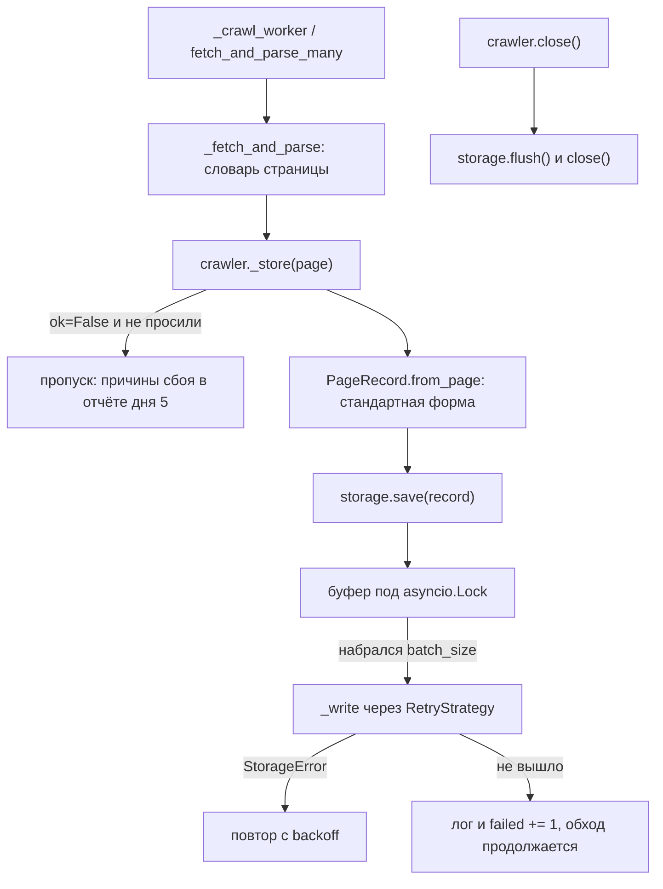

# Алгоритм: День 6 — сохранение данных и работа с файлами

## Путь страницы до диска



Три решения задают всю схему.

**Хук один.** Все разобранные страницы проходят через `_fetch_and_parse` — и
обход, и `fetch_and_parse_many`, и публичный `fetch_and_parse`, — поэтому
сохранение стоит там. Из-за этого же глубина передаётся в метод параметром:
записать её в страницу позже, в воркере, значило бы сохранить страницу без
глубины.

**Сохранение не имеет права сорвать обход.** `save()` не поднимает исключений:
страница уже загружена, и терять весь обход из-за заполненного диска нельзя.
Неудача попадает в лог и в счётчик `failed`.

**Буферизация и запись идут под одной блокировкой.** Страницы сохраняют
несколько воркеров одновременно, а файл один: без блокировки два батча
перемешались бы внутри файла.

## Стандартная форма записи

`PageRecord` в [../src/models.py](../src/models.py) — договор дня 6. Первые
восемь полей те, что названы в задании, дальше служебные: без них по
сохранённым данным не понять, с какой глубины пришла страница и почему она
пустая.

| Поле | Откуда | Зачем |
| --- | --- | --- |
| `url`, `title`, `text`, `links`, `metadata` | парсер (день 2) | сами данные |
| `crawled_at` | `fetched_at` результата загрузки | время ответа, а не время записи |
| `status_code`, `content_type` | заголовки ответа | что именно сохранили |
| `final_url` | адрес после редиректов | по нему считались относительные ссылки |
| `depth` | очередь обхода | насколько глубоко страница лежит |
| `ok`, `error`, `error_class`, `attempts`, `elapsed` | результат загрузки | что стоило её получить |

Имена полей не совпадают с ключами словаря страницы (`status` ->
`status_code`, `fetched_at` -> `crawled_at`): словарь страницы описывает
загрузку, а запись — сохранённые данные. `PageRecord.from_page` — единственное
место, где эти два словаря встречаются.

`crawled_at` заполняется при получении ответа, а не при записи: страница может
полежать в буфере, и время записи — это не время обхода.

## Форматы

| Формат | Класс | Когда выбирать | Цена |
| --- | --- | --- | --- |
| JSON-массив | `JSONStorage(path)` | отдать данные целиком, прочитать одной строкой кода | файл создаётся заново, дописать нельзя |
| JSONL | `JSONStorage(path, lines=True)` | длинный обход, дописывание между запусками | это поток документов, а не один JSON |
| CSV | `CSVStorage(path)` | открыть в редакторе или залить в таблицу | плоский: ссылки и метаданные лежат JSON-строками |
| SQLite | `SQLiteStorage(path)` | искать, фильтровать, обновлять страницы | схема фиксирована, нужен `aiosqlite` |
| сразу несколько | `MultiStorage([...])` | одни данные нужны и в базе, и в файле | общей транзакции нет |

### Почему у JSON два режима

Требования к файлу противоположные. Валидный JSON-массив читается одной
строкой кода, но дописать в него запись нельзя — закрывающая скобка уже стоит
на месте, поэтому при открытии файл создаётся заново. JSONL дописывается в
конец и переживает падение процесса, но это не один документ.

Запись в обоих режимах потоковая: записи уходят на диск батчами, а не
собираются целиком в памяти, поэтому обход на сотни тысяч страниц сохраняется
так же, как на десять. После каждого батча идёт `flush`, и файл можно читать,
не дожидаясь конца обхода: незакрытый массив `load()` тоже разбирает — данные в
нём уже есть, и отказываться их читать из-за отсутствия скобки неправильно.

### Почему строки CSV собирает стандартный модуль

В тексте страниц полно кавычек, запятых и переводов строк. Экранировать их
руками — верный способ однажды получить сдвинутые колонки, поэтому строку
формирует `csv.writer` в памяти, а `aiofiles` пишет уже готовый текст. Колонки
— поля `PageRecord` в порядке объявления, так что файл второго обхода совпадает
по структуре с файлом первого и строки просто дописываются; заголовок при этом
не повторяется. Перед дописыванием заголовок в файле сверяется со своими
колонками: строки с другим разделителем или другим их порядком легли бы в тот
же файл, и прочитать его потом не смог бы никто — причём выяснилось бы это
молча и уже после обхода.

Кодировка задаётся параметром (`encoding="cp1251"`), а `errors="replace"`
спасает от символов, которых в ней нет. По умолчанию `errors="strict"`: о
потере символа лучше узнать сразу.

Типы при чтении восстанавливаются (`links` и `metadata` из JSON, числа, `ok`),
потому что CSV типов не хранит, а читать ссылки строкой `["a", "b"]`
бессмысленно.

### Схема таблицы SQLite

```sql
CREATE TABLE pages (
    id INTEGER PRIMARY KEY AUTOINCREMENT,
    url TEXT NOT NULL UNIQUE,   -- на UNIQUE опирается UPSERT
    title TEXT, text TEXT,
    links TEXT, metadata TEXT,  -- JSON-строками
    crawled_at TEXT,            -- ISO 8601: сортировка совпадает с временем
    status_code INTEGER, content_type TEXT, final_url TEXT,
    depth INTEGER, ok INTEGER, error TEXT, error_class TEXT,
    attempts INTEGER, elapsed REAL
);
CREATE INDEX idx_pages_crawled_at ON pages (crawled_at);
CREATE INDEX idx_pages_status_code ON pages (status_code);
```

- `PRAGMA journal_mode=WAL` — чтобы базу можно было читать, пока обход пишет.
- Вставка идёт `executemany` с `INSERT ... ON CONFLICT(url) DO UPDATE`: второй
  обход обновляет страницу, а не плодит копии. Обновляется строка целиком,
  поэтому запись без ссылок затирает прежние — страница целиком свежая.
- Индексы под обычные вопросы к собранным данным: что собрали за последний час
  и какие страницы отдали ошибку. По `url` индекс уже есть — он `UNIQUE`.
- Если поле добавили в `PageRecord`, а в схему забыли, `SQLiteStorage` откажется
  создаваться: лучше узнать об этом сразу, а не на первой вставке.
- Читать можно и из закрытого хранилища, и из ещё не созданной базы — во втором
  случае ответ пустой, а не ошибка: файловые хранилища на отсутствующий файл
  ведут себя так же.
- `search()` экранирует `%` и `_` и объявляет в запросе `ESCAPE`: иначе поиск
  «100%» означал бы «100 и что угодно», а поиск одного «%» выдавал бы все
  страницы.

## Батчи

| Формат | `batch_size` по умолчанию | Почему так |
| --- | --- | --- |
| JSON, JSONL, CSV | 1 | дописать строку в файл дёшево, а данные сразу на диске |
| SQLite | 50 | каждая вставка — транзакция со сбросом на диск, и `executemany` на 50 записей стоит примерно как одна отдельная вставка |

При `batch_size` больше единицы `save()` возвращает `True` в значении «запись
принята»: она может ещё лежать в буфере, и о сбое её записи говорят результат
`flush()`/`close()` и счётчик `failed`.

Плата за батч — буфер в памяти: страницы между записями лежат в процессе, и
аварийное завершение их теряет. Поэтому `close()` досылает остаток, а
`flush()` позволяет сделать это в любой момент — демо-режим зовёт его перед
чтением данных обратно. Краулер в `close()` закрывает хранилище сам
(`close_storage=True`), а если закрывать его не просили — всё равно досылает
буфер.

## Ошибки записи

Повторы берутся из дня 5: `DataStorage` держит свою `RetryStrategy` с
`retry_on=(StorageError,)`, двумя повторами и базовой паузой 0.2 с.

| Что случилось | Класс | Повтор |
| --- | --- | --- |
| `OSError`: нет места, нет прав, заблокированная база | `StorageError` | да |
| `TypeError`/`ValueError`: запись не сериализуется | `StorageDataError` | нет |
| в `save()` передали не словарь и не `PageRecord` | `StorageDataError` | нет, и до буфера такая запись не доходит |
| CSV дописывают в файл с другим разделителем или другими колонками | `StorageDataError` | нет, файл не трогаем |

Классификация нужна именно потому, что решение о повторе `RetryStrategy`
принимает по классу ошибки: без собственного класса `OSError` считался бы
неизвестной ошибкой и не повторялся бы вовсе. Негодная запись отсекается до
буфера — иначе она ломала бы запись соседних страниц из того же батча.

Батч, который не записался и после повторов, теряется: держать его в памяти до
конца обхода значило бы расти без предела, а причина сбоя (нет места, нет прав)
сама не проходит. Потерянные записи видны в `failed` и в логе. Исключение —
`open()`: открыть хранилище просят явно и до обхода, поэтому там ошибка
поднимается, а не прячется в счётчик.

У `MultiStorage` сбои независимы: каждое хранилище решает про повторы само и
само считает неудачи, поэтому упавший формат не отменяет остальные и не
приводит к дублям в тех, куда запись удалась.

## Статистика

`get_crawl_stats()` получает раздел `storage`.

| Поле | Смысл |
| --- | --- |
| `storage`, `target`, `batch_size` | что за хранилище, куда пишет и каким батчем |
| `saved`, `failed` | записано и не записано записей |
| `batches`, `flushes`, `buffered` | записей в батчах, принудительных сбросов, сколько ждёт в буфере |
| `write_time`, `bytes` | время записи и размер файла или базы |
| `retries`, `retry_success` | повторы записи и сколько из них помогли |
| `last_error` | последняя ошибка записи текстом |
| `storages` | то же по каждому формату внутри `MultiStorage` |

Счётчики накопительные и между обходами не сбрасываются — в отличие от очереди
и лимитера. Файл после второго запуска содержит записи обоих запусков, и
счётчик, начинающийся с нуля, вводил бы в заблуждение.

## Демонстрация

```bash
python -m src.main --store                            # обход + JSON, CSV, SQLite + чтение обратно
python -m src.main --store --max-pages 30 --batch-size 10
python -m src.main --crawl --storage sqlite --max-pages 10
python -m src.main --crawl --storage jsonl csv --storage-path data/my_crawl
python -m src.main --parse --storage json --save-failed
```

Режим `--store` обходит сайт, пишет страницы сразу в три формата, печатает
статистику сохранения по каждому и читает данные обратно: первые записи из
JSON и CSV, а из базы — ещё и `COUNT(*)` с поиском по тексту.

## Что осталось за рамками дня

- **Общей транзакции у `MultiStorage` нет.** Файл и база не умеют коммититься
  вместе, поэтому возможна картина «в базу легло, в CSV нет». Это видно в
  статистике, но откатить запись нельзя.
- **PostgreSQL не подключён.** Для `asyncpg` нужен сервер, а оффлайн-тесты
  проекта на него опираться не могут. Место для него есть: достаточно нового
  наследника `DataStorage`.
- **Миграций схемы нет.** `CREATE TABLE IF NOT EXISTS` не меняет существующую
  таблицу, поэтому база от прошлой версии полей не получит. Проверка полей при
  создании хранилища только предупреждает об этом.
- **Текст страницы хранится целиком.** `text_limit` существует, но по умолчанию
  не ограничивает: обрезать данные молча хуже, чем занять место. Внутри
  `MultiStorage` запись строится один раз, поэтому `text_limit` применяется и к
  готовой записи — иначе у вложенных хранилищ он бы не работал.
- **Ссылки не разложены по отдельной таблице.** Запрос «кто ссылается на эту
  страницу» потребует разбора JSON; нормальная схема связей — отдельная тема.
- **Чтение не потоковое.** `load()` возвращает список, то есть читает файл или
  выборку целиком; для гигабайтного файла нужен был бы итератор.
- **Записи из `fetch_urls` не сохраняются.** Сохраняется то, что разобрано:
  у простой загрузки без парсинга нет ни заголовка, ни ссылок.
